# guided-ml

**A guided path through machine learning for beginners: frame the problem, explore the data, clean it without leakage, compare models, and report, by making informed choices instead of writing code.**

## Why this project

Most beginner ML projects go wrong before the first model is trained. The business question is never framed, statistics are computed on the whole dataset before the train/test split (data leakage), cleaning choices are made by habit rather than evidence, and AutoML tools hide every decision, so nothing is learned.

guided-ml takes the opposite approach. At every step it suggests what to do and explains why, the user makes the call, and every decision is backed by evidence and written to a plain-English log.

## How it works

```mermaid
flowchart LR
    A[0 Load + data quality] --> B[1 Frame the problem]
    B --> C[2 Leakage screen]
    C --> D[3 Split strategy]
    D --> E[4 EDA: uni / bi / multivariate]
    E --> F[5 Preprocess with evidence]
    F --> G[6 Model comparison]
    G --> H[7 Evaluate]
    H --> I[8 Explain + report]
```

**Principles**

- The tool suggests, the human decides: every suggestion comes with a reason and alternatives.
- Evidence for every option: distribution change and cross-validated score.
- Leakage-safe by design: everything is fitted on training data only.
- The original data is never modified, and every decision is logged.
- Each choice shows the matching Python code, so users learn while they work.

## Status

Design phase. See [ROADMAP.md](ROADMAP.md) for milestones and [docs/DESIGN.md](docs/DESIGN.md) for stage-by-stage design notes.

## Author

**Rajneesh Jaswal**: analytics graduate student with 16 years in automotive sales and marketing.

## License

Released into the public domain under [The Unlicense](LICENSE): anyone may use it for any purpose, without conditions. Provided "as is", without warranty of any kind.
